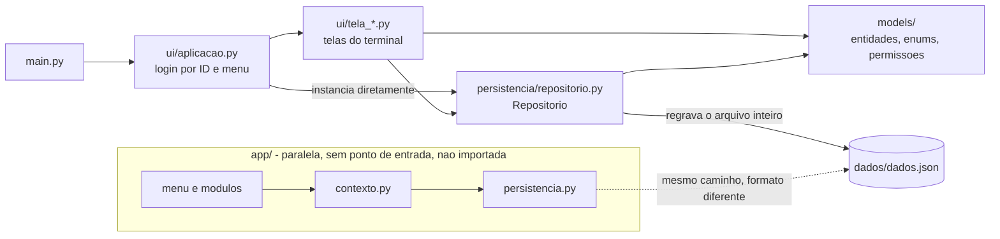
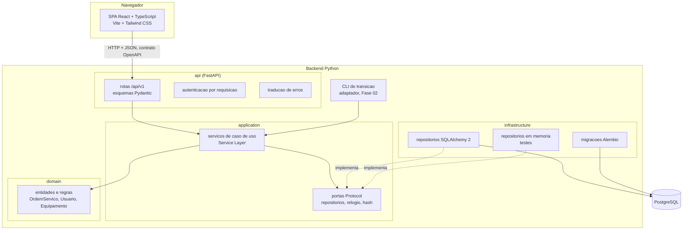
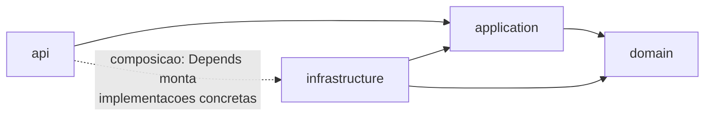
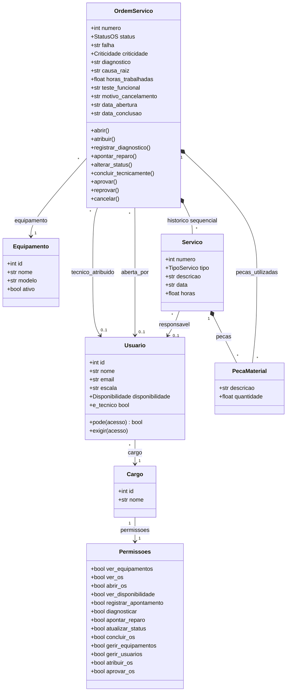
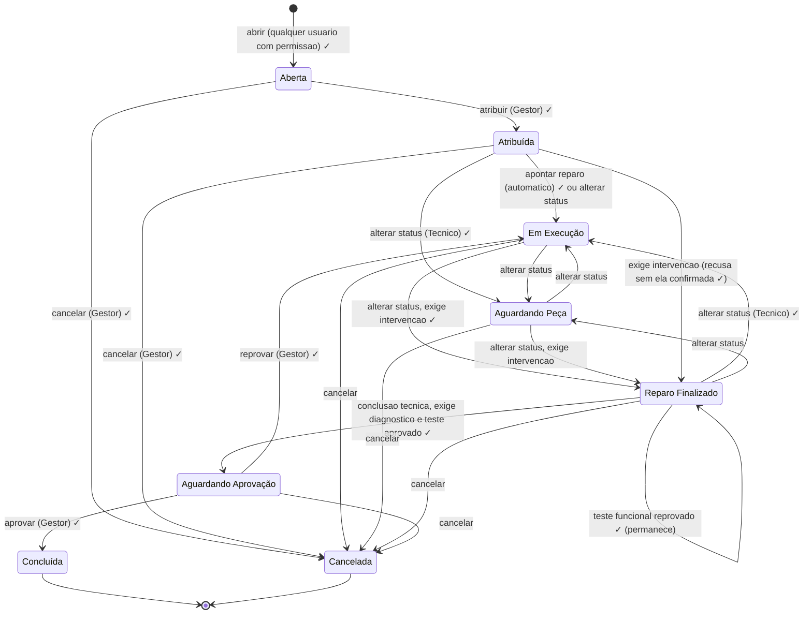
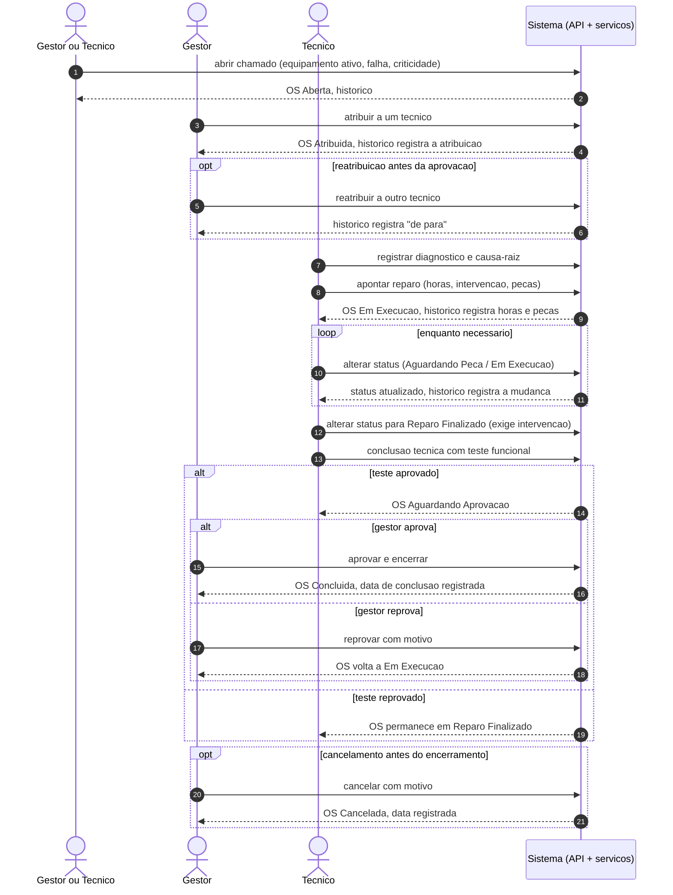

# Diagramas

Diagramas em [Mermaid](https://mermaid.js.org/) (renderizados pelo GitHub). Cada um indica se representa o **baseline
verificado** (código da Entrega 1) ou a **arquitetura-alvo** (planejada, **não implementada**).

| # | Diagrama | Representa |
|---|----------|------------|
| 1 | Componentes do baseline | Baseline verificado |
| 2 | Componentes do sistema-alvo | Alvo (não implementado) |
| 3 | Dependências entre camadas | Alvo (não implementado) |
| 4 | Entidades do domínio | Baseline verificado |
| 5 | Máquina de estados da OS | Baseline verificado |
| 6 | Fluxo principal das ordens de serviço | Alvo (comportamento a preservar) |
| 7 | Anatomia de uma operação na API | Alvo (não implementado) |

## 1. Componentes do baseline (Entrega 1)

Origem: leitura dos imports e do código (ver [`AUDITORIA_ARQUITETURAL.md`](AUDITORIA_ARQUITETURAL.md)).



## 2. Componentes do sistema-alvo

Direção aprovada para documentação (ADR-0001 e ADR-0002). Nomes de pacotes e de rotas serão definidos nas fases de
implementação.



## 3. Dependências entre camadas

Regra de dependência (ADR-0002): as setas indicam "pode importar". Qualquer seta no sentido oposto é defeito, verificado
por teste automatizado (ADR-0006).



Proibido (defeito se ocorrer): `domain` importar `application`, `infrastructure` ou `api`; `application` importar
`infrastructure` ou `api`; `domain` e `application` importarem FastAPI, SQLAlchemy ou Pydantic.

## 4. Entidades do domínio (baseline)

Origem: `models/*.py`. Campos de segredo ou de versão **não existem** no baseline; mudanças previstas estão listadas
abaixo do diagrama.



**Mudanças previstas (não implementadas):** credencial protegida por hash em `Usuario`; datas como tipo data/hora com
fuso; versão para controle otimista em `OrdemServico`; permissões como enumeração tipada; remoção de `to_dict`/`from_dict`
das entidades. Campos extras de `Equipamento` dependem de decisão (OPC-06 na [matriz](MATRIZ_RASTREABILIDADE.md)).

## 5. Máquina de estados da OS (baseline)

Origem: métodos de `models/ordem_servico.py`. As transições marcadas com ✓ foram confirmadas por execução (2026-11-15);
as demais vêm da leitura do código e **não foram executadas**.



Observações verificadas:
- Reatribuir é recusado em "Aguardando Aprovação" ✓ e permitido em "Em Execução" mantendo o status ✓; pelo código, também é
  permitido nos demais status não finais (não executado). A atribuição a partir de "Aberta" muda o status para "Atribuída" ✓.
- O diagnóstico só é aceito em Atribuída, Em Execução e Aguardando Peça (ver AUD-21 na auditoria).
- Cancelar uma OS já encerrada é recusado ✓.

## 6. Fluxo principal das ordens de serviço

Comportamento da Entrega 1 que deve ser **preservado** na aplicação web. Os nomes das rotas serão definidos na Fase 04.



## 7. Anatomia de uma operação na API (alvo)

Exemplo: **apontar reparo**. Mostra onde cada responsabilidade reside (ADR-0003) e como os erros são traduzidos.

```mermaid
sequenceDiagram
    autonumber
    participant SPA as SPA React
    participant API as api (rota)
    participant AUT as autenticacao
    participant SVC as application (servico)
    participant REP as porta OrdemServicoRepository
    participant DOM as domain (OrdemServico)
    participant DB as PostgreSQL

    SPA->>API: requisicao com credencial e dados do reparo
    API->>API: valida formato (esquema Pydantic)
    API->>AUT: identificar usuario
    AUT-->>API: usuario autenticado (senao 401)
    API->>SVC: apontar_reparo(usuario, id da OS, dados)
    SVC->>REP: obter OS por id
    REP->>DB: SELECT da OS com historico e pecas
    DB-->>REP: registros e versao
    REP-->>SVC: entidade OrdemServico
    SVC->>SVC: autoriza (permissao e OS do tecnico; senao 403)
    SVC->>DOM: apontar_reparo(horas, intervencao, pecas)
    DOM-->>SVC: estado e historico atualizados (senao 409 ou 422)
    SVC->>REP: salvar OS
    REP->>DB: UPDATE condicionado a versao
    alt versao desatualizada
        DB-->>REP: nenhuma linha atualizada
        REP-->>SVC: conflito de concorrencia
        SVC-->>API: erro
        API-->>SPA: 409
    else gravado
        DB-->>REP: confirmacao
        SVC-->>API: resultado
        API-->>SPA: 200 com a OS atualizada
    end
```
