# Diagramas

Diagramas em [Mermaid](https://mermaid.js.org/) (renderizados pelo GitHub). O documento tem duas partes:

* **Parte A: arquitetura implementada.** Conferida no código do commit `8427977` (tag `entrega-2`). Nomes de classes,
  módulos e rotas são os reais.
* **Parte B: planejamento histórico** (Fases 00 a 02). Preservada como registro das propostas. Os diagramas do
  baseline (Entrega 1) continuam corretos para a CLI legada; os de "alvo" foram **superados** pela Parte A (foram
  planejados antes da implementação, usavam, por exemplo, Tailwind CSS, que não foi adotado).

| # | Diagrama | Representa |
|---|---|---|
| A1 | Arquitetura geral | Implementado |
| A2 | Dependências entre camadas | Implementado (verificado por `tests/arquitetura/`) |
| A3 | Fluxo de autenticação | Implementado |
| A4 | Ciclo de vida da ordem de serviço | Implementado (`domain/transicoes.py`) |
| A5 | Frontend → API → serviços → persistência | Implementado |
| H-1 a H-7 | Baseline e alvo planejado | Histórico |

# Parte A: arquitetura implementada

## A1. Arquitetura geral

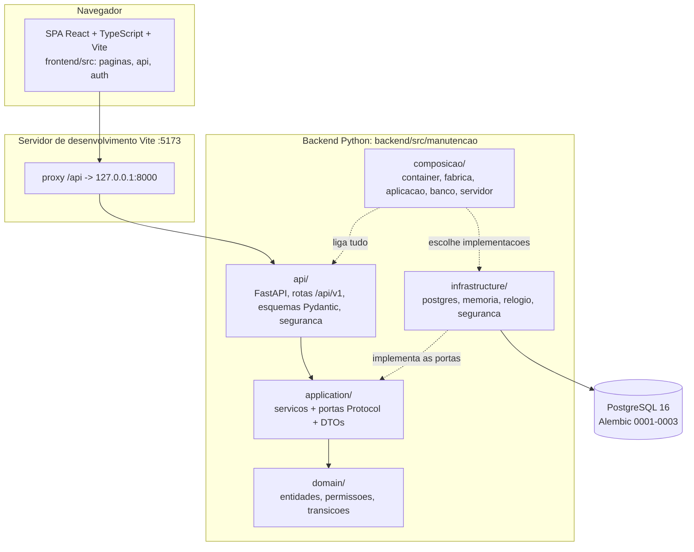

## A2. Dependências entre camadas

As setas cheias são `import`. A camada `composicao` é a única que conhece todas. `domain` não importa ninguém.

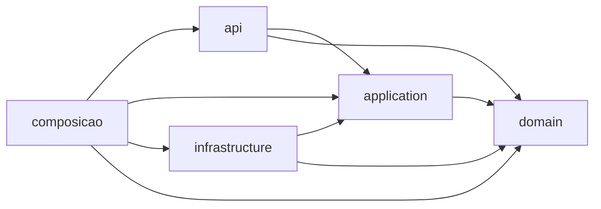

## A3. Fluxo de autenticação (login por matrícula)

Fonte: `api/rotas/autenticacao.py`, `application/servicos/autenticacao.py`, `api/seguranca.py`.

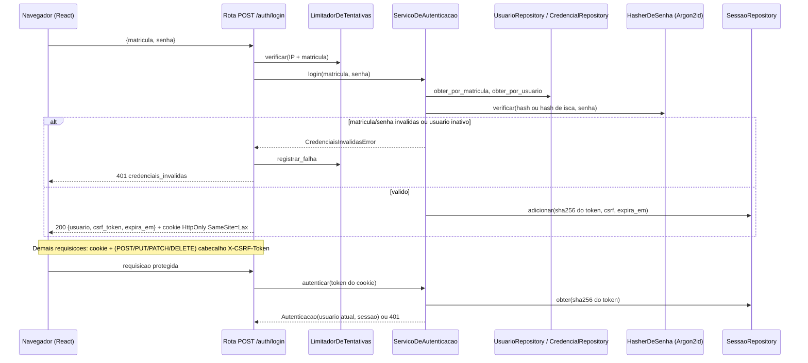

## A4. Ciclo de vida da ordem de serviço

Fonte: `_TABELA` em `domain/transicoes.py` (as pré-condições de cada operação ficam em `OrdemServico`).

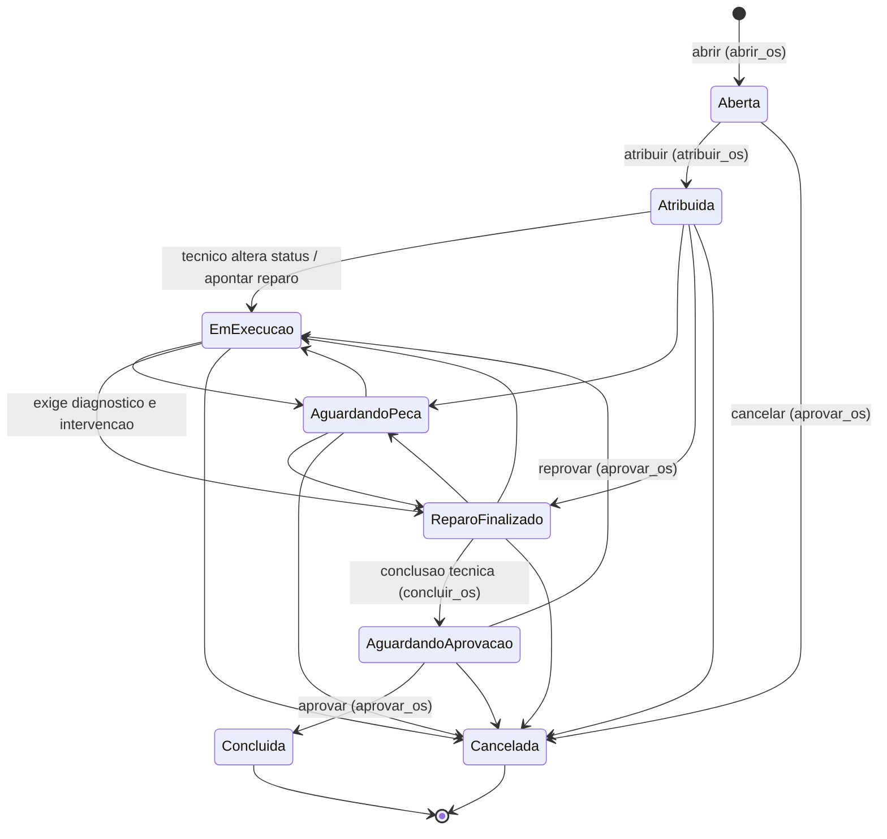

Nomes na interface: Aberta, Atribuída, Em Execução, Aguardando Peça, Reparo Finalizado, Aguardando Aprovação,
Concluída, Cancelada.

## A5. Interação frontend → API → serviços → persistência (exemplo: aprovar uma OS)

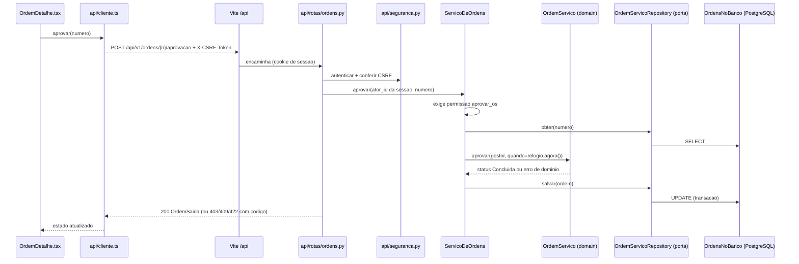

---

# Parte B: planejamento histórico (Fases 00 a 02)

Os diagramas abaixo foram preservados sem alteração de conteúdo. **H-1, H-4 e H-5** representam o baseline da
Entrega 1 e continuam válidos para a CLI. **H-2, H-3, H-6 e H-7** são o alvo planejado na época e foram superados
pela Parte A (consulte-a para o que existe de fato).

### H-1. Componentes do baseline (Entrega 1)

Origem: leitura dos imports e do código (ver [`AUDITORIA_ARQUITETURAL.md`](AUDITORIA_ARQUITETURAL.md)).

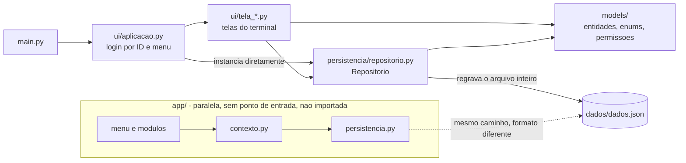

### H-2. Componentes do sistema-alvo

Direção aprovada para documentação (ADR-0001, ADR-0002 e ADR-0008). O pacote do backend será
`backend/src/manutencao/` (D-14). Nomes de rotas serão definidos nas fases de implementação. Por D-10 (aprovada),
não há CLI sobre os novos serviços: a CLI legada permanece intacta e fora do sistema-alvo; a interface principal é web.

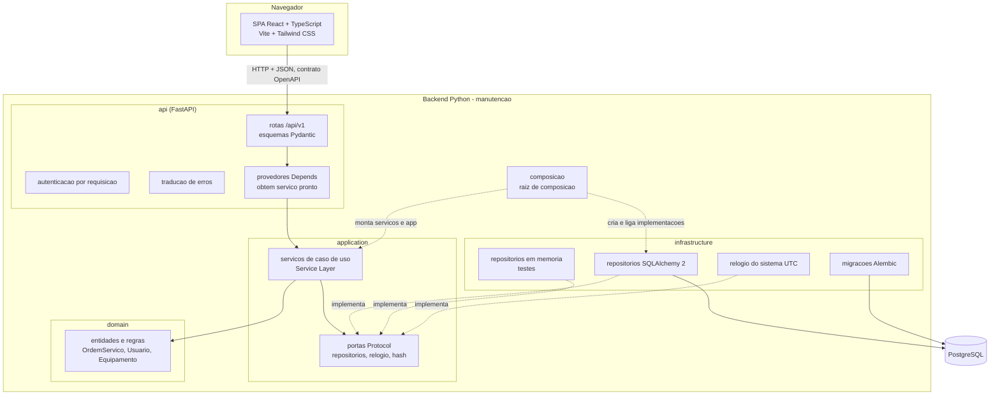

### H-3. Dependências entre camadas

Regra de dependência (ADR-0002): as setas indicam "pode importar". Qualquer seta no sentido oposto é defeito, verificado
por teste automatizado (ADR-0006).

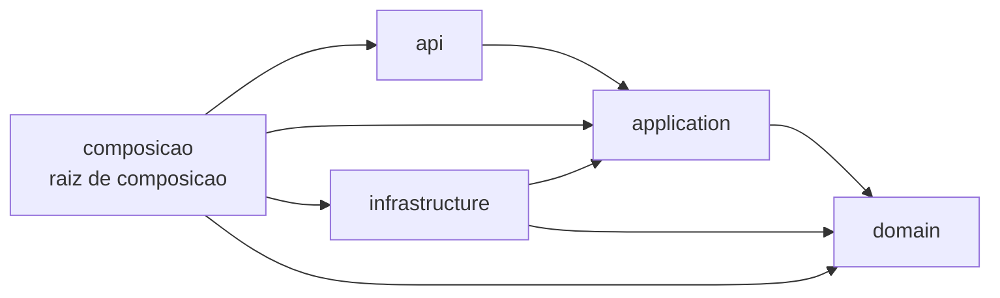

Dependências permitidas por camada:

| Camada | Pode importar |
|--------|---------------|
| `domain` | Somente a biblioteca padrão |
| `application` | `domain` |
| `infrastructure` | `application` (portas) e `domain` |
| `api` | `application` e `domain` (tipos) |
| `composicao` | Todas as camadas (é a única que conhece as implementações concretas) |

Proibido (defeito se ocorrer): `domain` importar `application`, `infrastructure`, `api` ou `composicao`; `application`
importar `infrastructure`, `api` ou `composicao`; `api` importar `infrastructure`; qualquer camada importar `composicao`;
`domain` e `application` importarem FastAPI, SQLAlchemy ou Pydantic. O relógio é uma porta de `application`; o instante é
entregue ao domínio como argumento (ADR-0007).

### H-4. Entidades do domínio (baseline)

Origem: `models/*.py`. Campos de segredo ou de versão **não existem** no baseline; mudanças previstas estão listadas
abaixo do diagrama.

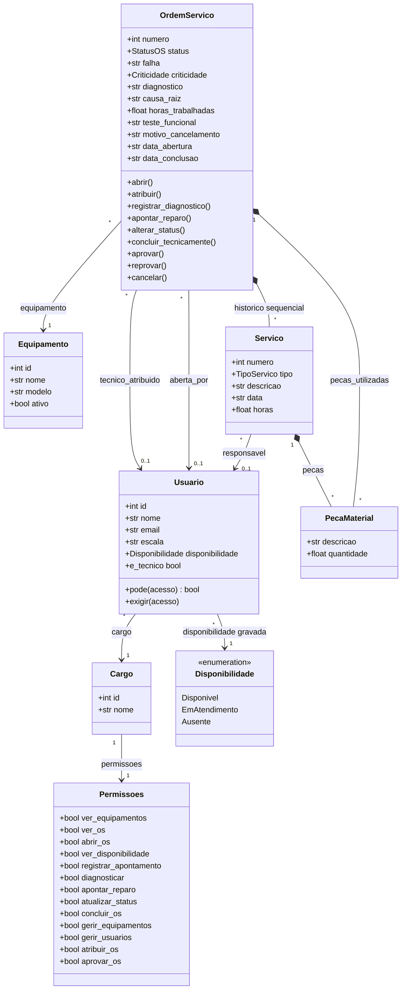

**Disponibilidade no baseline:** é um **atributo gravado** em `Usuario`, atualizado pelo `Repositorio` quando a interface
chama `atualizar_disponibilidades()` (`persistencia/repositorio.py:112-119`); `Ausente` é definido manualmente. `e_tecnico`
é derivado da permissão `apontar_reparo`, não do cargo (AUD-20).

**Mudanças previstas (não implementadas):**
- papel (Gestor ou Técnico) explícito no domínio, independente das permissões (D-02);
- ausência manual registrada **separadamente** e disponibilidade operacional **calculada** a partir das OS Em Execução,
  com a ausência prevalecendo (D-05); deixa de ser atributo gravado;
- campo `ativo` em `Usuario` (desativação sem exclusão);
- datas como `datetime` com fuso, armazenadas em UTC (D-11);
- credencial protegida por hash em `Usuario`; versão para controle otimista em `OrdemServico`; permissões como
  enumeração tipada; remoção de `to_dict`/`from_dict` das entidades.

Campos extras de `Equipamento` dependem de decisão (D-07/OPC-06 na [matriz](MATRIZ_RASTREABILIDADE.md)).

### H-5. Máquina de estados da OS (baseline)

Origem: métodos de `models/ordem_servico.py`. As transições marcadas com ✓ foram confirmadas por execução (2026-11-15);
as demais vêm da leitura do código e **não foram executadas**.

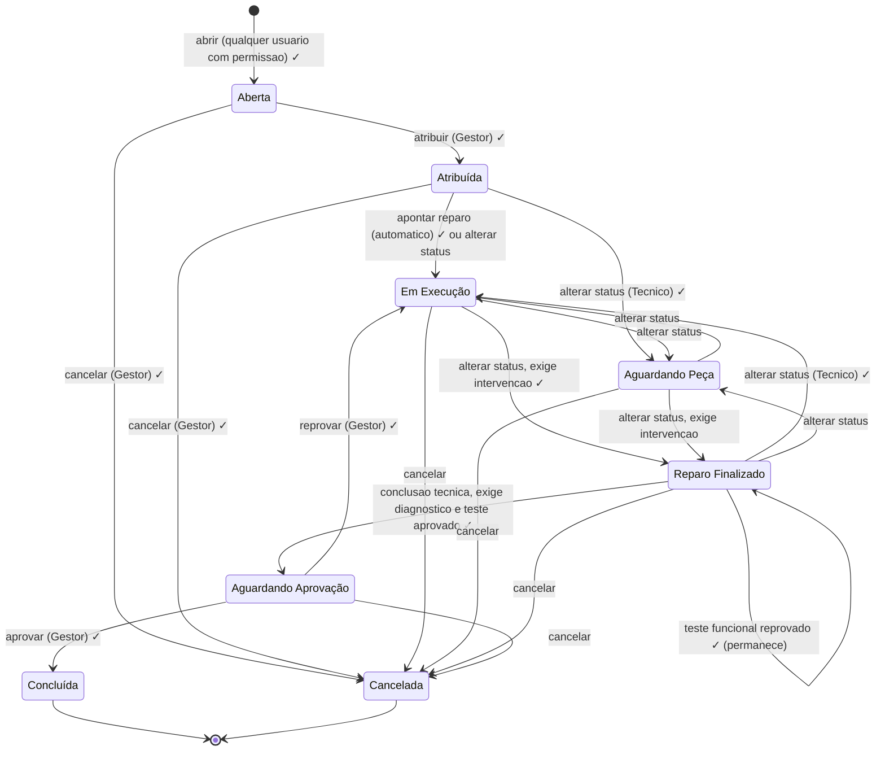

Observações verificadas:
- **Não há transição direta Atribuída → Reparo Finalizado.** O código permite tentar (`alterar_status` aceita a
  origem Atribuída), mas exige ao menos uma intervenção, e a primeira intervenção (`apontar_reparo`) já move a OS para
  Em Execução (`ordem_servico.py:118-119,133-134`). Por isso a aresta não existe no diagrama (a recusa sem intervenção foi
  confirmada por execução).
- **Alvo (D-06, não implementado):** a transição para Reparo Finalizado passa a exigir também o diagnóstico registrado;
  as demais arestas acima são preservadas.
- Reatribuir é recusado em "Aguardando Aprovação" ✓ e permitido em "Em Execução" mantendo o status ✓; pelo código, também é
  permitido nos demais status não finais (não executado). A atribuição a partir de "Aberta" muda o status para "Atribuída" ✓.
- O diagnóstico só é aceito em Atribuída, Em Execução e Aguardando Peça (ver AUD-21 na auditoria).
- Cancelar uma OS já encerrada é recusado ✓.

### H-6. Fluxo principal das ordens de serviço

Comportamento da Entrega 1 que deve ser **preservado** na aplicação web, com as mudanças aprovadas assinaladas (D-03 a
D-06, **não implementadas**). Os nomes das rotas serão definidos na Fase 04.

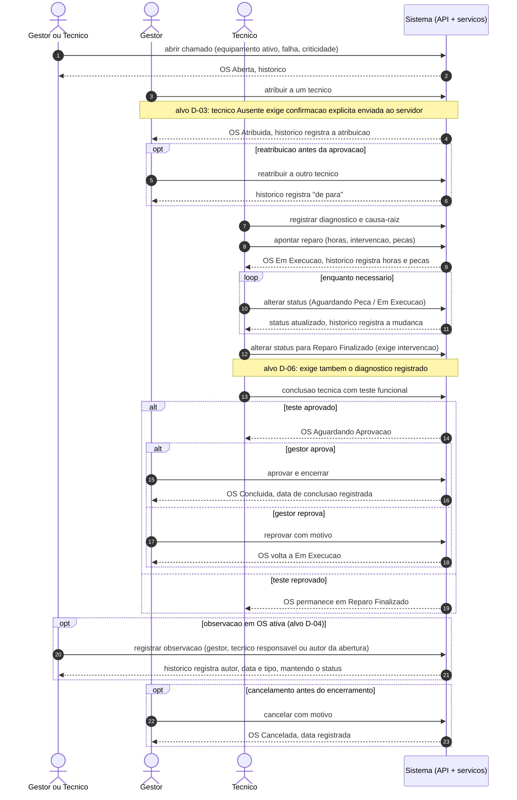

### H-7. Anatomia de uma operação na API (alvo)

Exemplo: **apontar reparo**. Mostra onde cada responsabilidade reside (ADR-0003), como o relógio é obtido pela aplicação
e entregue ao domínio (ADR-0007) e como os erros são traduzidos. Serviço e repositório chegam à rota já montados pela raiz
de composição (ADR-0005), que não aparece na sequência por atuar na inicialização.

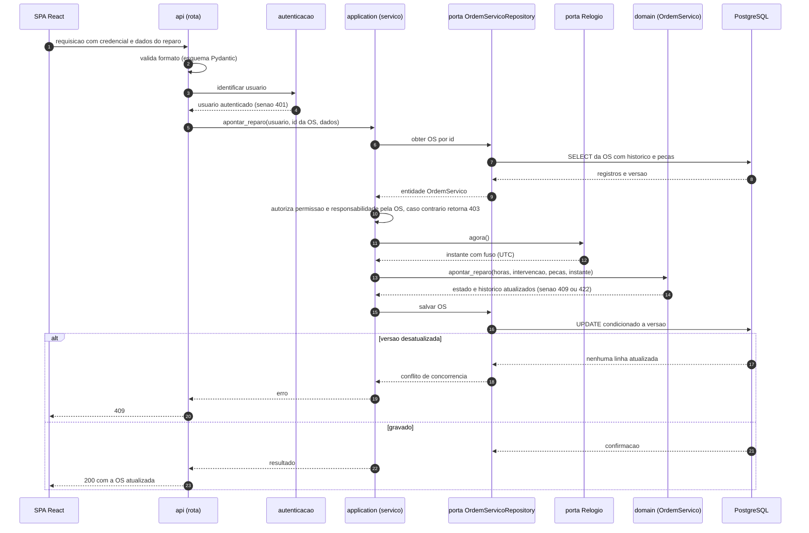
